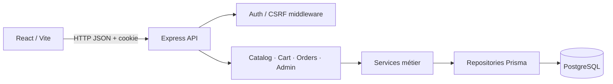

# Architecture

## Vue d’ensemble

Le navigateur communique avec l’API en JSON. En développement, Vite relaie le préfixe `/api`, ce qui conserve une origine unique côté navigateur. En production, `CLIENT_ORIGIN` doit correspondre exactement à l’origine du client.

## Découpage applicatif

- `apps/api/src/app.ts` compose Express, CORS, Helmet, parseurs, routes et gestionnaire centralisé d’erreurs.
- Chaque module API sépare routes et validation Zod, service métier, contrat TypeScript et repository Prisma.
- `apps/web/src/features/` regroupe composants, types et appels API par fonctionnalité.
- `prisma/schema.prisma` est la source du schéma relationnel ; les migrations versionnées sont appliquées avec `prisma migrate deploy`.

## Décisions de sécurité et cohérence

- Les sessions sont des JWT HS256 à durée limitée, stockés dans un cookie HttpOnly. Les mutations exigent un jeton CSRF double-submit ; les routes d’administration exigent un compte authentifié avec le rôle `ADMIN`.
- Les montants restent en Decimal en base et sont convertis en centimes entiers pour calculer le total de commande. Le client ne soumet ni prix ni total.
- La commande vérifie et décrémente le stock, crée les lignes historisées, puis vide le panier dans une transaction.
- Les produits sont désactivés plutôt que supprimés de façon destructive ; les commandes conservent leurs instantanés.
- Le paiement de démonstration est signalé comme tel et ne recueille aucune donnée de carte.

## Limites connues

- Pas de prestataire de paiement, livraison, téléversement d’images, notifications, pagination de l’administration, observabilité centralisée ou déploiement de production.
- Les migrations et le seed nécessitent un PostgreSQL accessible ; les tests unitaires/intégration HTTP actuels s’appuient sur des doubles et n’appliquent pas réellement la migration.
