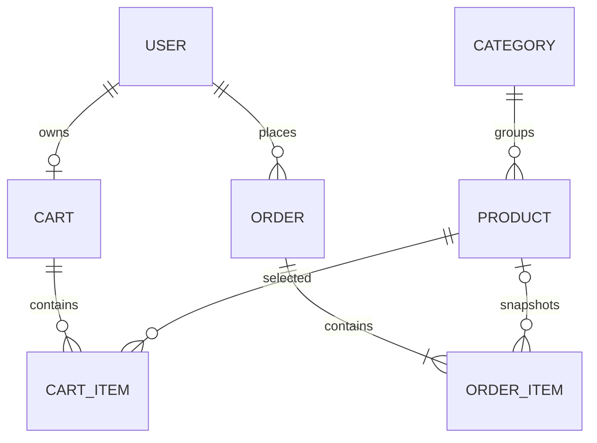

# Modèle de données

Le schéma est défini dans [`prisma/schema.prisma`](../prisma/schema.prisma). Les migrations Prisma font foi pour les évolutions de la base ; les modifications manuelles de schéma doivent être répercutées dans une migration versionnée.

## Décisions

- `User.role` distingue les clients des administrateurs ; les mots de passe sont stockés sous forme de hash dans `passwordHash`.
- Un panier persistant est associé à chaque compte. La clé composée de `CartItem` empêche qu'un même produit soit dupliqué dans un panier.
- Les montants utilisent `Decimal(10, 2)` plutôt que des nombres flottants.
- Une ligne de commande conserve le nom et le prix unitaire au moment de l'achat. Le lien vers le produit est facultatif afin que l'historique reste lisible si le produit est supprimé.
- Les commandes conservent une copie de l'adresse de livraison. L'état de commande et l'état de paiement sont distincts ; le paiement initial du projet sera simulé.
- Les catégories référencées ne peuvent pas être supprimées. Les produits peuvent être désactivés avec `isActive` pour les retirer du catalogue sans perdre les références historiques.
- Les contraintes métier (stock positif, quantité positive, prix positif) doivent aussi être validées dans les services avant les écritures.

## Données de démonstration

`prisma/seed.ts` insère de façon répétable une catégorie et trois produits d'exemple sans écraser les valeurs déjà modifiées. Il peut aussi créer un administrateur si `ADMIN_EMAIL` et `ADMIN_PASSWORD` sont définis ; le mot de passe doit contenir au moins 12 caractères et est stocké avec Argon2id. Si l'adresse existe déjà, le seed ne modifie que son rôle et conserve son mot de passe actuel. Ces variables doivent être fournies uniquement dans l'environnement d'exécution et jamais ajoutées au dépôt.
